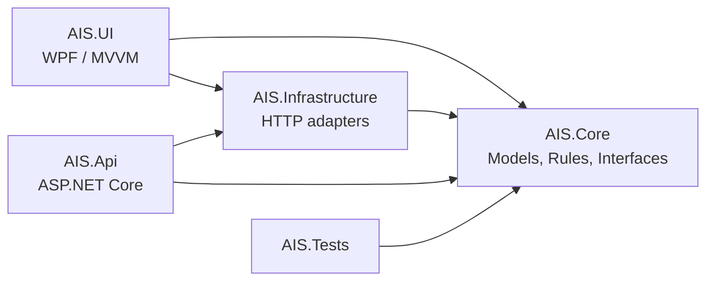
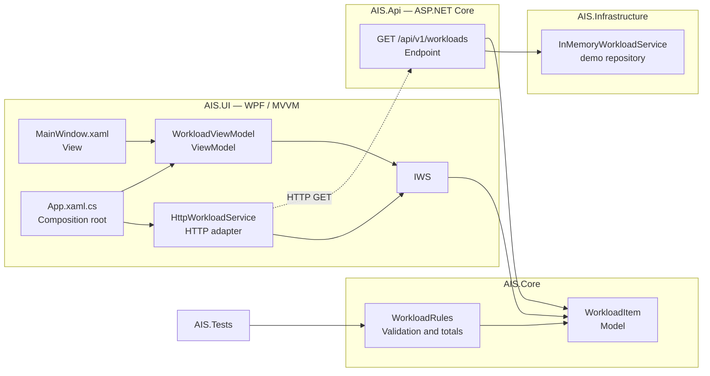

# ОТЧЁТ ПО ПРАКТИЧЕСКОЙ РАБОТЕ № 7

## Разработка диаграммы модулей и структуры проекта для АИС

**Вариант № 5**  
**АИС «Управление студенческой нагрузкой»**

| Сведения | Значение |
|---|---|
| Дисциплина | МДК 02.02 Инструментальные средства разработки и отладки ПО |
| Студент | Вихров Александр Алексеевич |
| Группа | И14-23-9 |
| Вариант | 5 |
| Модуль ИС | АИС «Управление студенческой нагрузкой» |
| Руководитель | Чудинова Александра Анатольевна |
| Дата | «____» ______________ 20____ г. |

> При переносе отчёта в Word установить шрифт Times New Roman, 14 пт.

## Введение

Практическая работа № 7 продолжает проектирование АИС «Управление студенческой нагрузкой» в материалах ПР1–ПР6. Цель работы — распределить код по проектам .NET Solution, выделить предметную модель и правило расчёта, а также задать зависимости, направленные к ядру системы. В приложении сохранены WPF-клиент и HTTP API, спроектированные в ПР6.

## 1 Состав проектов в Solution

Решение `AIS.StudentLoad.sln` включает следующие проекты:

| Проект | Каталог | Тип | Назначение |
|---|---|---|---|
| `AIS.Core` | `src/AIS.Core/` | Class Library | Модель `WorkloadItem`, интерфейс `IWorkloadService` и правило проверки/суммирования нагрузки. Содержит бизнес-логику без привязки к UI и сети. |
| `AIS.Infrastructure` | `src/AIS.Infrastructure/` | Class Library | Реализация `IWorkloadService` через HTTP-клиент, сериализация ответа API и адаптация внешних данных к моделям Core. |
| `AIS.UI` | `src/AIS.UI/` | WPF Application | Клиентский интерфейс по MVVM: View, ViewModel и точка композиции, связывающая Core с Infrastructure. |
| `AIS.Api` | `src/AIS.Api/` | ASP.NET Core Web API | HTTP endpoint `GET /api/v1/workloads`, отдающий данные в формате контракта ПР6. Это внешний серверный компонент приложения. |
| `AIS.Tests` | `tests/AIS.Tests/` | Console Application | Самостоятельно запускаемые проверки правил Core без зависимости от стороннего тестового пакета. |

Структура каталогов:

```text
pr7/
├── src/
│   ├── AIS.Core/
│   │   ├── Models/
│   │   ├── Rules/
│   │   └── Services/
│   ├── AIS.Infrastructure/
│   │   └── Services/
│   ├── AIS.UI/
│   │   ├── MainWindow.xaml
│   │   ├── App.xaml.cs
│   │   └── ViewModels/
│   └── AIS.Api/
├── tests/
│   └── AIS.Tests/
├── AIS.StudentLoad.sln
└── REPORT.md
```

## 2 Направление зависимостей между слоями

`AIS.Core` — внутреннее ядро. Он не ссылается на UI, Infrastructure, API или тестовый проект. Интерфейс `IWorkloadService` объявлен в Core, а его HTTP-реализация находится во внешнем Infrastructure. Поэтому бизнес-логика зависит от абстракции, а не от сетевой реализации.

WPF UI использует типы и интерфейсы Core. В точке запуска UI создаёт HTTP-реализацию из Infrastructure и передаёт её ViewModel. API использует инфраструктурную реализацию для предоставления endpoint. Tests ссылается на Core, чтобы проверять правила независимо от сети и интерфейса.



Стрелка показывает ссылку проекта на другой проект. Core не имеет исходящих зависимостей. UI и API являются внешними точками сборки приложения и используют Infrastructure для подключения реализации интерфейсов Core. Отдельные зависимости Core от UI, API или Infrastructure не допускаются.

## 3 Диаграмма компонентов C4 Level 3

На уровне компонентов показаны части трёх основных модулей и путь получения данных от API до пользовательского интерфейса.



Интерфейс `IWorkloadService` и тип `WorkloadItem` принадлежат Core. `HttpWorkloadService` реализует интерфейс для WPF-клиента, а `InMemoryWorkloadService` предоставляет демонстрационный источник API. API возвращает модель Core; в промышленной версии in-memory реализация может быть заменена адаптером хранения без изменения доменных правил.

| Компонент | Проект | Ответственность |
|---|---|---|
| `WorkloadItem` | Core / Models | Модель строки нагрузки, общей для API, клиента и доменных правил. |
| `IWorkloadService` | Core / Services | Абстракция получения нагрузки; не зависит от HTTP или UI. |
| `WorkloadRules` | Core / Rules | Проверяет допустимость записи и суммирует плановые часы. |
| `HttpWorkloadService` | Infrastructure / Services | Запрашивает endpoint и преобразует JSON в модели Core. |
| `InMemoryWorkloadService` | Infrastructure / Services | Возвращает демонстрационные строки для API. |
| `WorkloadViewModel` | UI / ViewModels | Состояние, поиск, команды обновления и обработка ошибок для View. |
| `MainWindow.xaml` | UI | Представление данных через WPF bindings. |
| `GET /api/v1/workloads` | API | Фильтрует демонстрационный набор и возвращает строки нагрузки. |
| `Program.cs` | Tests | Запускает проверки доменных правил Core. |

## Заключение

В работе определён состав .NET Solution для АИС «Управление студенческой нагрузкой»: Core, Infrastructure, UI, API и Tests. Модель и правила расчёта выделены во внутренний проект Core; сетевой код помещён во внешний Infrastructure; клиент и API используют эти компоненты как точки входа. Такая структура сохраняет правила предметной области независимыми от конкретного интерфейса и способа обмена данными и продолжает архитектуру MVVM и контракт API.
