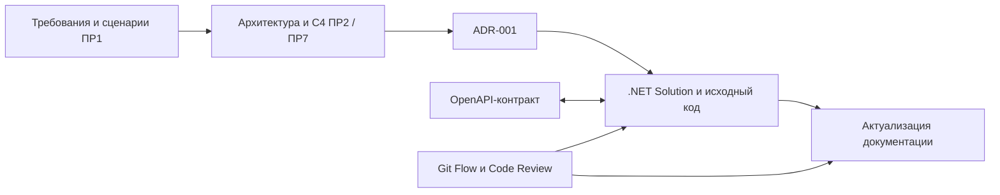

# ОТЧЁТ ПО ПРАКТИЧЕСКОЙ РАБОТЕ № 8

## Разработка перечня артефактов и протоколов проекта

**Вариант № 5**  
**АИС «Управление студенческой нагрузкой»**

| Сведения | Значение |
|---|---|
| Дисциплина | МДК 02.02 Инструментальные средства разработки и отладки ПО |
| Студент | Вихров Александр Алексеевич |
| Группа | И14-23-9 |
| Вариант | 5 |
| Модуль ИС | АИС «Управление студенческой нагрузкой» |
| Руководитель | Чудинова Александра Анатольевна |
| Дата | «15»11.2026 г. |

## Введение

Практическая работа № 8 продолжает материалы ПР1–ПР7. Цель — зафиксировать минимально необходимый комплект документации и командных регламентов для разработки АИС «Управление студенческой нагрузкой», указать расположение артефактов и принять ключевое архитектурное решение. Прототип уже содержит .NET Solution, WPF-клиент, ASP.NET Core API и OpenAPI-контракт; постоянное хранилище и промышленная авторизация в прототип не включены.

## 1 Паспорт артефактов проекта

| Ключевой артефакт | Содержание и назначение | Файл в комплекте | Формат / состояние | Ответственный и актуализация |
|---|---|---|---|---|
| Архитектурный | Границы системы, слои, компоненты, связи и направление зависимостей к Core. | [`artifacts/architecture.md`](artifacts/architecture.md) | Markdown + Mermaid| Tech Lead; обновлять при изменении проектов, границ или зависимостей. |
| Контрактный | API получения расчётной нагрузки, параметры запроса, модели ответа и ошибки. | [`artifacts/contracts/openapi.yaml`](artifacts/contracts/openapi.yaml) | OpenAPI 3.0.3 | Разработчик API совместно с Tech Lead; изменение контракта отражать в API и клиенте в одном PR или связанных PR. |
| Кодовой | Исходники Core, Infrastructure, UI и API, Solution и проверки доменных правил. | [`artifacts/codebase.md`](artifacts/codebase.md) | C#/.NET Solution | Developer; код меняется через feature/bugfix-ветку и Pull Request по правилам Git Flow. |
| Управленческий | Регламент ветвления, роли, Pull Request, Code Review и связь изменений с задачами. | [`artifacts/process/CONTRIBUTING.md`](artifacts/process/CONTRIBUTING.md) | Markdow | Tech Lead |

### Схема связей артефактов

## 2 Запись архитектурного решения ADR-001

**Название:** использование .NET/C# и разделения на Core, Infrastructure и UI  
**Статус:** принято для учебного прототипа  
**Дата:** «____» ______________ 20____ г.  
**Контекст:** система проектируется в рамках дисциплины «Инструментальные средства разработки и отладки ПО». Требуется единая типизированная кодовая база для правил расчёта учебной нагрузки, HTTP API и настольного клиентского приложения. В ПР6 выбран WPF-клиент с MVVM и ASP.NET Core API; ПР7 выделила доменное ядро и инфраструктурные реализации в отдельные проекты.

**Решение:** использовать C#/.NET и .NET Solution с проектами `AIS.Core`, `AIS.Infrastructure`, `AIS.UI`, `AIS.Api` и `AIS.Tests`. Модели, интерфейсы и правила расчёта размещать в Core. Реализации HTTP-доступа и источников данных — в Infrastructure. WPF-представления и ViewModel — в UI. HTTP endpoint — в API. Проверки доменных правил — в Tests. Core не должен ссылаться на другие проекты; Infrastructure зависит от Core; внешние проекты подключают реализации на границе приложения.

**Последствия:**

- правила нагрузки можно проверять без запуска UI или API;
- клиентская MVVM-архитектура и серверное API используют согласованные модели и контракты;
- реализацию источника данных можно заменять, не перенося сетевые или хранилищные детали в Core;
- настольный WPF-клиент рассчитан на Windows;
- в текущем прототипе данные демонстрационные и находятся в памяти; подключение постоянного хранилища и промышленной авторизации требует отдельных решений и обновления паспорта артефактов.

Полная запись решения находится в [`artifacts/decisions/ADR-001-dotnet-layering.md`](artifacts/decisions/ADR-001-dotnet-layering.md).

## Заключение

Сформирован минимальный паспорт из четырёх обязательных артефактов: архитектурного, контрактного, кодового и управленческого. Для каждого определены назначение, файл и порядок актуализации. В ADR-001 зафиксирован выбор .NET/C# и разделения на Core, Infrastructure и внешние проекты UI/API. Такой набор связывает требования, реализацию и командный процесс в единую документацию проекта.
