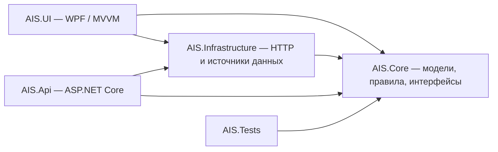

# Архитектурный артефакт

АИС «Управление студенческой нагрузкой» разделена на доменное ядро, инфраструктурные реализации и внешние точки входа. Основное правило: Core не зависит от UI, API или Infrastructure.

Core содержит `WorkloadItem`, `IWorkloadService` и `WorkloadRules`. Infrastructure реализует получение данных через HTTP для клиента и демонстрационный источник в памяти для API. UI содержит View и ViewModel, API предоставляет `GET /api/v1/workloads`, а Tests проверяет правила Core.

Изменения зависимостей и состава проектов документируются вместе с соответствующим Pull Request и при необходимости новым ADR.
